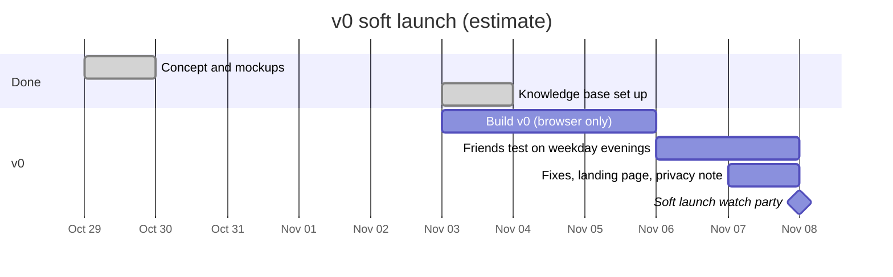

# Status

Last updated: 2026-11-03.

Newest items at the top of each list. Tick items off (`[x]`) and add the date; never delete them.

**Where it stands:** concept and mockups are done. A weekend v0 (browser-only) has been proposed but not started: it waits on Krischan's go-ahead and a code repository. See [scope.md](scope.md).

## Timeline

Estimates. The v0 build has not been approved yet.

## Checklist

### To do

- [ ] Decide whether to start v0 now, and where the code repository lives ([open questions](open-questions.md))
- [ ] Test the oshi mark lab on phones, laptops and browsers; choose plain or pixelated marks
- [ ] Ask Krischan's cousin about the name
- [ ] Decide whether tips pay for the team's time ([monetization](../product/monetization.md#open))
- [ ] Build v0 ([scope](scope.md))
- [ ] Line up 3 to 5 testers and one scheduled stream for the launch watch party
- [ ] Short privacy note
- [ ] Replace AI placeholder art before anything is public ([decision 0004](../decisions/0004-no-ai-art.md))
- [ ] Choose a tip platform that pays out in the Philippines

### Done

- [x] 2026-11-03 Knowledge base set up ([log](../logs/2026-11-03-knowledge-base-set-up.md))
- [x] 2026-11-02 Weekend v0 plan and monetization pathways proposed (see [scope](scope.md), [monetization](../product/monetization.md))
- [x] 2026-10-29 Oshi mark lab published for cross-device testing ([map](../map/accounts.md#mockups-and-tools))
- [x] 2026-10-29 Landing page mockup ([map](../map/accounts.md#mockups-and-tools))
- [x] 2026-10-29 Two-screen window mockup, three rounds of feedback ([experience](../product/experience.md))
- [x] 2026-10-29 Original handoff reviewed and reworked ([research](../research/2026-10-29-original-handoff-review.md))
